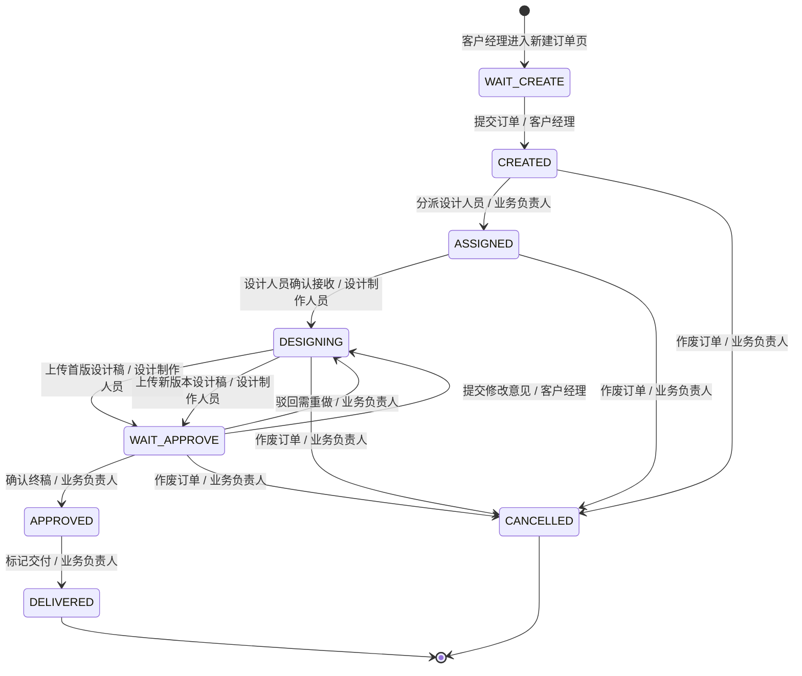

# 广告制作公司宣传物料订单管理系统 · 产品需求规格说明书（PRD）

> 文档版本：v1.0  
> 文档状态：MVP 定稿  
> 适用范围：广告制作公司宣传物料订单管理系统  
> 关联文档：USER_STORIES.md（用户故事与 BDD 验收标准）

---

## 1. 系统概述与 MVP 业务边界

### 1.1 项目全称

**广告制作公司宣传物料订单管理系统（Advertising Material Order Management System, AMOMS）**

### 1.2 建设目标

建设一套面向广告制作公司内部使用的宣传物料订单全流程管理系统，实现从客户需求登记、任务分派、设计制作、修改迭代到最终交付的全链路线上化管理，解决当前线下沟通效率低、版本混乱、进度不透明、交付资料散乱等核心问题。

### 1.3 解决的业务痛点

| 编号 | 痛点描述 | 影响角色 | 严重程度 |
|---|---|---|---|
| P-01 | 订单需求通过微信/电话口头传达，信息易遗漏、易失真 | 客户经理 / 设计人员 | 高 |
| P-02 | 设计稿版本管理混乱，无法追溯哪版是最新、对应哪次修改意见 | 全部角色 | 高 |
| P-03 | 业务负责人不掌握设计师实时负荷，任务分派不均 | 业务负责人 | 中 |
| P-04 | 修改意见分散在微信、邮件、电话中，无法集中追溯 | 客户经理 / 设计人员 | 高 |
| P-05 | 订单进度不透明，客户经理需频繁询问才能向客户同步 | 客户经理 | 中 |
| P-06 | 交付文件格式不统一、渠道散乱（U盘/微信/邮箱） | 全部角色 | 中 |

### 1.4 MVP 最小闭环定义

**MVP 核心闭环：一笔宣传物料订单从登记到交付的全流程线上化。**

覆盖业务链路：

```
登记 → 分派 → 设计 → 修改 → 定稿 → 交付
```

具体包含：
- 宣传物料订单的登记与录入（客户名称、物料类型、数量、规格、交期、参考资料）
- 业务负责人对订单进行审核与设计人员分派
- 设计人员接收任务、上传设计稿、迭代修改
- 修改意见在线流转与版本记录
- 最终稿确认与订单交付归档
- 订单全流程状态可视化追踪

### 1.5 版本边界说明

本 MVP 版本仅实现线上订单流转功能，**不包含以下模块**（详见第 6 章非目标清单）：
- 财务结算与报价管理
- 物料库存与采购管理
- 客户档案 CRM 系统
- 人力资源与考勤管理
- 多分支机构组织架构
- 数据报表与 BI 分析
- 移动端 App

---

## 2. 角色与 RBAC 权限矩阵表

### 2.1 角色定义

| 角色编码 | 角色名称 | 角色说明 |
|---|---|---|
| GUEST | 访客 | 未登录用户，仅可访问登录页面 |
| AM | 客户经理 | 订单发起人，负责对接客户需求、登记订单、提交修改意见、确认交付 |
| BL | 业务负责人 | 订单管理者，负责分派任务、监控进度、质量审核、确认终稿交付 |
| DS | 设计制作人员 | 设计执行者，负责接收任务、上传设计稿、按意见迭代修改 |

### 2.2 RBAC 权限矩阵

| 操作项 | 访客 Guest | 客户经理 AM | 业务负责人 BL | 设计制作人员 DS |
|---|:---:|:---:|:---:|:---:|
| 新建订单 | ❌ | ✅ | ❌ | ❌ |
| 编辑订单（本人创建） | ❌ | ✅（仅待分派状态） | ❌ | ❌ |
| 编辑订单（全部） | ❌ | ❌ | ✅（仅待分派状态） | ❌ |
| 分派任务（指定设计人员） | ❌ | ❌ | ✅ | ❌ |
| 上传设计稿（首版） | ❌ | ❌ | ❌ | ✅（本人负责的订单） |
| 上传新版本设计稿 | ❌ | ❌ | ❌ | ✅（本人负责的订单，修改中状态） |
| 提交修改意见 | ❌ | ✅（本人创建的订单，待审核状态） | ✅ | ❌ |
| 确认定稿 | ❌ | ❌ | ✅ | ❌ |
| 标记交付 | ❌ | ❌ | ✅ | ❌ |
| 删除订单 | ❌ | ❌ | ✅（仅待分派状态） | ❌ |
| 查看全部订单 | ❌ | 🔍（本人创建的） | ✅ | 🔍（本人负责的） |
| 查看订单详情 | ❌ | ✅（本人创建的） | ✅ | ✅（本人负责的） |
| 查看设计稿版本 | ❌ | ✅（本人创建的） | ✅ | ✅（本人负责的） |
| 查看修改意见记录 | ❌ | ✅（本人创建的） | ✅ | ✅（本人负责的） |
| 作废订单 | ❌ | ❌ | ✅ | ❌ |

> **权限标记说明：** ✅ 允许操作　　❌ 禁止操作　　🔍 仅可查看（只读）

---

## 3. 订单全生命周期状态机

### 3.1 状态定义

| 状态编码 | 状态名称 | 状态说明 |
|---|---|---|
| WAIT_CREATE | 待登记 | 客户经理进入新建订单页但尚未提交，草稿状态 |
| CREATED | 已登记 | 客户经理已提交订单，等待业务负责人分派（即"待分派"） |
| ASSIGNED | 已分派 | 业务负责人已指定设计人员，设计人员尚未开始（即"设计中"起始状态） |
| DESIGNING | 设计中 | 设计人员正在进行设计制作，尚未提交首版 |
| WAIT_APPROVE | 待定稿 | 设计稿已提交，等待审核（含初稿审核与修改稿审核） |
| APPROVED | 已定稿 | 业务负责人已确认终稿，待交付归档 |
| DELIVERED | 已交付 | 订单已完成交付，归档状态 |
| CANCELLED | 已作废 | 订单因客户取消或其他原因作废，终止流程 |

### 3.2 状态流转图



### 3.3 状态流转规则表

| 序号 | 起始状态 | 目标状态 | 触发操作 | 操作角色 | 前置条件 |
|---|---|---|---|---|---|
| T-01 | WAIT_CREATE | CREATED | 提交订单 | 客户经理 | 必填项全部填写并通过校验 |
| T-02 | CREATED | ASSIGNED | 分派设计人员 | 业务负责人 | 订单状态为 CREATED，已选择设计人员 |
| T-03 | ASSIGNED | DESIGNING | 确认接收任务 | 设计制作人员 | 订单已分派给当前设计人员 |
| T-04 | DESIGNING | WAIT_APPROVE | 上传首版设计稿 | 设计制作人员 | 设计文件格式校验通过 |
| T-05 | WAIT_APPROVE | DESIGNING | 提交修改意见 | 客户经理 | 订单状态为 WAIT_APPROVE，意见内容非空 |
| T-06 | WAIT_APPROVE | DESIGNING | 驳回需重做 | 业务负责人 | 订单状态为 WAIT_APPROVE |
| T-07 | DESIGNING | WAIT_APPROVE | 上传新版本设计稿 | 设计制作人员 | 订单存在待处理修改意见 |
| T-08 | WAIT_APPROVE | APPROVED | 确认终稿 | 业务负责人 | 订单状态为 WAIT_APPROVE |
| T-09 | APPROVED | DELIVERED | 标记交付 | 业务负责人 | 订单状态为 APPROVED |
| T-10 | CREATED / ASSIGNED / DESIGNING / WAIT_APPROVE | CANCELLED | 作废订单 | 业务负责人 | 订单未交付，未作废 |

---

## 4. 功能模块详细规格与业务规则字典

### 4.1 订单登记模块

#### 4.1.1 功能描述

客户经理将客户宣传物料需求录入系统，生成一笔新的订单记录，订单创建后状态为"已登记（CREATED / 待分派）"，等待业务负责人分派。

#### 4.1.2 字段规格字典

| 字段名称 | 字段编码 | 字段类型 | 必填/选填 | 长度限制 | 格式校验 | 业务联动逻辑 |
|---|---|---|---|---|---|---|
| 订单编号 | order_no | 字符串 | 系统生成 | 20 字符 | 格式：ORD-YYYY-NNNNN | 提交后由系统自动生成，不可编辑 |
| 客户名称 | customer_name | 字符串 | 必填 | 2~100 字符 | 不可全为空格，不可包含 < > & " ' 特殊字符 | 用于订单列表展示与搜索 |
| 联系人姓名 | contact_name | 字符串 | 必填 | 2~20 字符 | 仅允许中文、英文字母 | 客户对接人姓名 |
| 联系电话 | contact_phone | 字符串 | 必填 | 11 字符 | 中国大陆手机号格式：1[3-9]\d{9} | 列表页脱敏显示（中间 4 位为*），详情页完整显示 |
| 物料类型 | material_type | 枚举 | 必填 | — | 可选值：海报/宣传单/名片/画册/喷绘/其他 | 影响设计稿文件尺寸模板建议 |
| 数量 | quantity | 整数 | 必填 | 1~99999 | 正整数，不可为 0 或负数 | 用于订单详情展示 |
| 规格说明 | specification | 字符串 | 必填 | 5~200 字符 | 不可包含 HTML 标签 | 描述尺寸、材质、工艺等要求 |
| 交付日期 | delivery_date | 日期 | 必填 | — | 必须晚于当前日期，早于当前日期+365天 | 用于提醒与排序 |
| 参考文件 | reference_files | 文件数组 | 选填 | 最多 5 个文件 | 格式：jpg/png/webp/pdf，单文件≤5MB | 辅助设计人员理解需求 |
| 备注说明 | remark | 字符串 | 选填 | 0~500 字符 | 不可包含 HTML 标签 | 其他补充说明 |
| 创建人 | created_by | 用户ID | 系统生成 | — | 当前登录客户经理 | 提交后自动写入，不可编辑 |
| 创建时间 | created_at | 时间戳 | 系统生成 | — | 服务器当前时间 | 提交后自动写入，不可编辑 |

#### 4.1.3 业务规则

| 规则编号 | 规则描述 | 关联场景 |
|---|---|---|
| R-ORD-001 | 必填字段为空时，提交按钮点击后在对应字段下方显示红色错误提示，不发起后端请求 | US-001 场景 2 |
| R-ORD-002 | 联系电话格式不匹配时，前端实时校验并提示"请输入正确的手机号码" | US-001 场景 2 |
| R-ORD-003 | 数量输入 0 或负数时，前端校验拦截并提示"数量必须大于 0" | US-001 场景 2 |
| R-ORD-004 | 交付日期早于当前日期时，前端校验拦截并提示"交付日期不能早于今天" | US-001 场景 2 |
| R-ORD-005 | 提交按钮点击后立即置为禁用态并显示"提交中..."，防止重复提交 | US-001 场景 3 |
| R-ORD-006 | 订单提交成功后，订单状态为 CREATED（已登记/待分派），自动跳转到订单详情页 | US-001 场景 1 |
| R-ORD-007 | 所有文本输入字段在提交前进行 XSS 字符清洗，过滤 <script>、<iframe> 等 HTML 标签 | 安全规范 |
| R-ORD-008 | 参考文件上传格式不在白名单内时，前端拦截并提示"仅支持 jpg/png/webp/pdf 格式" | US-001 场景 2 |

---

### 4.2 任务分派模块

#### 4.2.1 功能描述

业务负责人查看"已登记（待分派）"状态的订单列表，为每笔订单指定一名设计制作人员，分派后订单状态流转为"已分派（ASSIGNED）"，设计人员可在"我的任务"中看到该订单。

#### 4.2.2 字段规格字典

| 字段名称 | 字段编码 | 字段类型 | 必填/选填 | 长度限制 | 格式校验 | 业务联动逻辑 |
|---|---|---|---|---|---|---|
| 设计负责人 | designer_id | 用户ID | 必填 | — | 必须为设计制作人员角色的有效用户 | 分派操作的核心字段 |
| 分派时间 | assigned_at | 时间戳 | 系统生成 | — | 服务器当前时间 | 分派操作完成后自动写入 |
| 分派人 | assigned_by | 用户ID | 系统生成 | — | 当前登录业务负责人 | 分派操作完成后自动写入 |
| 分派备注 | assign_remark | 字符串 | 选填 | 0~100 字符 | 不可包含 HTML 标签 | 可填写分派说明 |

#### 4.2.3 业务规则

| 规则编号 | 规则描述 | 关联场景 |
|---|---|---|
| R-ASG-001 | 分派时未选择设计人员就点击确认，前端拦截并提示"请选择设计人员" | US-002 场景 2 |
| R-ASG-002 | 订单已被其他负责人分派时（并发冲突），后提交者操作失败，提示"该订单已被其他负责人分派，请刷新列表" | US-002 场景 3 |
| R-ASG-003 | 分派成功后订单状态由 CREATED 变为 ASSIGNED，订单列表中状态标签同步更新 | US-002 场景 1 |
| R-ASG-004 | 分派采用乐观锁机制，提交时携带订单当前版本号，版本号不匹配则拦截并发操作 | US-002 场景 3 |
| R-ASG-005 | 分派成功后，设计人员"我的任务"列表中自动新增该订单，状态为"已分派" | US-002 场景 1 |
| R-ASG-006 | 已分派/设计中/待定稿状态的订单，不可再次分派 | 状态约束 |
| R-ASG-007 | 业务负责人可在待分派状态下编辑订单基本信息，分派后不可编辑 | RBAC 权限 |

---

### 4.3 稿件修改模块

#### 4.3.1 功能描述

设计人员上传设计稿，客户经理或业务负责人提交修改意见，设计人员根据意见上传新版本，形成"提交→反馈→修改→再提交"的迭代循环，直至终稿确认。

#### 4.3.2 设计稿字段规格字典

| 字段名称 | 字段编码 | 字段类型 | 必填/选填 | 长度限制 | 格式校验 | 业务联动逻辑 |
|---|---|---|---|---|---|---|
| 版本号 | version_no | 字符串 | 系统生成 | 10 字符 | 格式：V1、V2、V3... 递增 | 首版自动为 V1，后续版本自动递增 |
| 设计文件 | design_file | 文件URL | 必填 | — | 格式白名单：psd/ai/jpg/png/pdf/webp | 源文件直传 OSS，数据库存 URL |
| 文件大小 | file_size | 整数 | 系统生成 | — | 单文件≤100MB（源文件） | 上传完成后自动记录 |
| 版本说明 | version_note | 字符串 | 必填 | 1~200 字符 | 不可包含 HTML 标签 | 描述本版修改内容 |
| 上传人 | uploaded_by | 用户ID | 系统生成 | — | 当前登录设计人员 | 上传时自动写入 |
| 上传时间 | uploaded_at | 时间戳 | 系统生成 | — | 服务器当前时间 | 上传完成后自动写入 |
| 关联订单 | order_id | 订单ID | 系统生成 | — | 必须为有效订单ID | 与订单关联 |

#### 4.3.3 修改意见字段规格字典

| 字段名称 | 字段编码 | 字段类型 | 必填/选填 | 长度限制 | 格式校验 | 业务联动逻辑 |
|---|---|---|---|---|---|---|
| 意见内容 | feedback_content | 文本 | 必填 | 1~500 字符 | 不可包含 HTML 标签、脚本代码 | 修改意见的核心内容 |
| 关联版本 | version_id | 版本ID | 系统生成 | — | 必须为订单当前最新版本 | 默认关联当前最新设计稿版本 |
| 提交人 | submitted_by | 用户ID | 系统生成 | — | 当前登录用户 | 提交时自动写入 |
| 提交时间 | submitted_at | 时间戳 | 系统生成 | — | 服务器当前时间 | 提交时自动写入 |
| 意见状态 | feedback_status | 枚举 | 系统生成 | — | 待处理/已处理 | 新建时默认"待处理"，上传新版本后自动变为"已处理" |

#### 4.3.4 业务规则

| 规则编号 | 规则描述 | 关联场景 |
|---|---|---|
| R-DSG-001 | 设计中状态下，设计人员可上传首版设计稿，上传成功后订单状态变为 WAIT_APPROVE（待定稿） | US-004 场景 1 |
| R-DSG-002 | 上传文件格式不在白名单内时，前端拦截并提示"仅支持 PSD/AI/JPG/PNG/PDF/WebP 格式" | US-004 场景 2 |
| R-DSG-003 | 待定稿状态下，"上传设计稿"按钮为禁用态，不可上传新版本 | US-004 场景 3 |
| R-DSG-004 | 待定稿状态下，客户经理可提交修改意见，提交后订单状态变为 DESIGNING（设计中/修改中） | US-005 场景 1 |
| R-DSG-005 | 修改意见内容为空时，前端拦截并提示"请输入修改意见" | US-005 场景 2 |
| R-DSG-006 | 已交付状态下，修改意见输入框为禁用态，不可提交新意见 | US-005 场景 3 |
| R-DSG-007 | 存在待处理修改意见时，设计人员可上传新版本，版本号自动递增（V1→V2→V3...） | US-006 场景 1 |
| R-DSG-008 | 版本说明超过 200 字符时，前端校验拦截并提示"版本说明不能超过 200 字" | US-006 场景 2 |
| R-DSG-009 | 无待处理修改意见时，页面不显示"上传新版本"按钮，仅显示"上传设计稿"按钮（首版） | US-006 场景 3 |
| R-DSG-010 | 设计稿版本按倒序排列（最新版在顶部），每条版本可展开查看对应修改意见 | US-006 场景 1 |
| R-DSG-011 | 上传新版本后，对应修改意见状态自动由"待处理"变为"已处理" | 业务联动 |
| R-DSG-012 | 所有设计稿文件直传 OSS，业务数据库仅存储文件 URL，不存储二进制文件 | 架构约束 |

---

### 4.4 定稿审核模块

#### 4.4.1 功能描述

业务负责人对设计稿进行质量审核，确认最终版本后将订单标记为"已定稿（APPROVED）"，进入交付环节。业务负责人也可在审核时直接给出修改意见，将订单驳回至设计中状态。

#### 4.4.2 字段规格字典

| 字段名称 | 字段编码 | 字段类型 | 必填/选填 | 长度限制 | 格式校验 | 业务联动逻辑 |
|---|---|---|---|---|---|---|
| 定稿版本 | final_version_id | 版本ID | 系统生成 | — | 必须为订单当前最新版本 | 确认终稿时自动记录当前版本为最终版 |
| 定稿时间 | approved_at | 时间戳 | 系统生成 | — | 服务器当前时间 | 确认终稿时自动写入 |
| 定稿人 | approved_by | 用户ID | 系统生成 | — | 当前登录业务负责人 | 确认终稿时自动写入 |
| 审核意见 | approve_note | 字符串 | 选填 | 0~200 字符 | 不可包含 HTML 标签 | 定稿时可填写审核说明 |
| 驳回意见 | reject_note | 字符串 | 驳回时必填 | 1~500 字符 | 不可包含 HTML 标签 | 驳回时必须填写驳回原因 |

#### 4.4.3 业务规则

| 规则编号 | 规则描述 | 关联场景 |
|---|---|---|
| R-APR-001 | 待定稿状态下，业务负责人可点击"确认终稿"，确认后订单状态变为 APPROVED（已定稿） | US-007 场景 1 |
| R-APR-002 | 确认终稿时，当前最新设计稿版本自动标记为"最终版"，版本列表中显示徽章 | US-007 场景 1 |
| R-APR-003 | 审核备注超过 100 字符时，前端校验拦截并提示"备注内容超长，请精简至 100 字以内" | US-007 场景 2 |
| R-APR-004 | 两人同时确认终稿时（并发冲突），先提交者成功，后提交者操作失败，提示"该订单已由其他负责人确认交付，请刷新查看" | US-007 场景 3 |
| R-APR-005 | 已定稿状态下，不可再上传新设计稿、不可再提交修改意见 | 状态约束 |
| R-APR-006 | 驳回时必须填写驳回意见，为空则拦截并提示"请填写驳回原因" | 业务规则 |
| R-APR-007 | 驳回后订单状态由 WAIT_APPROVE 变为 DESIGNING，驳回意见作为一条修改意见记录 | 业务联动 |
| R-APR-008 | 定稿确认采用乐观锁机制，提交时携带订单当前版本号，版本号不匹配则拦截并发操作 | US-007 场景 3 |

---

### 4.5 交付闭环模块

#### 4.5.1 功能描述

业务负责人在确认终稿后，将订单标记为"已交付（DELIVERED）"，系统自动归档订单记录，完成一笔订单的全流程闭环。已交付订单在各角色的"进行中"列表中移除，可在历史记录中查询。

#### 4.5.2 字段规格字典

| 字段名称 | 字段编码 | 字段类型 | 必填/选填 | 长度限制 | 格式校验 | 业务联动逻辑 |
|---|---|---|---|---|---|---|
| 交付时间 | delivered_at | 时间戳 | 系统生成 | — | 服务器当前时间 | 标记交付时自动写入 |
| 交付人 | delivered_by | 用户ID | 系统生成 | — | 当前登录业务负责人 | 标记交付时自动写入 |
| 交付备注 | deliver_remark | 字符串 | 选填 | 0~100 字符 | 不可包含 HTML 标签 | 交付时可填写备注 |
| 归档标识 | is_archived | 布尔值 | 系统生成 | — | true/false | 交付后自动设为 true |

#### 4.5.3 业务规则

| 规则编号 | 规则描述 | 关联场景 |
|---|---|---|
| R-DEL-001 | 已定稿状态下，业务负责人可点击"标记交付"，确认后订单状态变为 DELIVERED（已交付） | US-007 场景 1 |
| R-DEL-002 | 交付后订单自动归档，在"进行中"列表中不再显示，仅在"全部订单/历史订单"中可查 | US-003 场景 3 |
| R-DEL-003 | 已交付状态下，所有编辑操作（修改订单、上传设计稿、提交意见、分派）全部禁用 | 状态约束 |
| R-DEL-004 | 已交付订单详情页顶部显示"本订单已交付归档"横幅提示 | US-007 场景 1 |
| R-DEL-005 | 设计稿版本列表中，最终版旁显示"最终版"徽章，不可删除 | US-007 场景 1 |
| R-DEL-006 | 交付备注超过 100 字符时，前端校验拦截并提示"交付备注不能超过 100 字" | US-007 场景 2 |
| R-DEL-007 | 客户经理可查看本人创建的已交付订单详情及全部设计稿版本，但不可编辑 | RBAC 权限 |
| R-DEL-008 | 设计人员可查看本人负责的已交付订单详情，但不可编辑 | RBAC 权限 |

---

### 4.6 订单列表与查询模块

#### 4.6.1 功能描述

各角色根据权限查看对应范围内的订单列表，支持按状态筛选、按关键词搜索、游标分页加载。

#### 4.6.2 业务规则

| 规则编号 | 规则描述 | 关联场景 |
|---|---|---|
| R-LST-001 | 客户经理默认看到本人创建的所有订单，按创建时间倒序排列 | RBAC 权限 |
| R-LST-002 | 业务负责人默认看到全部订单，按创建时间倒序排列 | RBAC 权限 |
| R-LST-003 | 设计人员默认看到分派给本人的订单，按分派时间倒序排列 | US-003 场景 1 |
| R-LST-004 | 列表支持按状态筛选：全部/待分派/设计中/待定稿/已交付/已作废 | 列表功能 |
| R-LST-005 | 搜索支持按订单编号、客户名称模糊匹配，搜索关键词进行 XSS 清洗 | US-003 场景 2 |
| R-LST-006 | 列表使用 Cursor 游标分页，每页 20 条，禁止使用 Offset 分页 | 性能规范 |
| R-LST-007 | 列表中联系电话脱敏显示：138****1234 | 安全规范 |
| R-LST-008 | 搜索输入特殊字符（如 <script>）时，正常返回空结果，不执行脚本 | US-003 场景 2 |

---

## 5. 非功能性需求（NFR）

### 5.1 安全性要求

| 编号 | 需求描述 | 量化指标 | 验证方式 |
|---|---|---|---|
| NFR-SEC-001 | 前端所有输入开启 XSS 字符清洗，过滤 HTML 标签、脚本代码 | 输入 `<script>alert(1)</script>` 后，提交内容被转义或过滤，页面无弹窗 | 渗透测试 + 自动化扫描 |
| NFR-SEC-002 | 客户联系电话做隐私脱敏，列表页只展示手机号中间 4 位隐藏 | 列表页显示格式为 `138****1234`，详情页可完整显示 | 页面截图验证 |
| NFR-SEC-003 | 所有接口必须携带登录令牌，无令牌请求直接拦截并返回 401 | 未携带 Token 的请求 100% 返回 HTTP 401 状态码 | 接口测试 |
| NFR-SEC-004 | 禁止直接拼接 SQL 语句，防止注入攻击 | 使用 ORM 参数化查询，SQL 注入测试用例全部拦截 | 安全审计 + 渗透测试 |
| NFR-SEC-005 | 接口层面做越权访问校验，用户只能访问权限范围内的订单数据 | 尝试访问他人订单详情时返回 HTTP 403 | 接口测试 |
| NFR-SEC-006 | 用户密码使用 bcrypt 加盐哈希存储，不可明文存储或可逆加密 | 数据库中密码字段为哈希值，强度 ≥ 10 轮 | 数据库审计 |
| NFR-SEC-007 | 登录失败 5 次后账号锁定 30 分钟，防止暴力破解 | 连续失败 5 次后返回"账号已锁定"提示 | 功能测试 |

### 5.2 媒体资源规范（物料图片 / 源文件）

| 编号 | 需求描述 | 量化指标 | 验证方式 |
|---|---|---|---|
| NFR-MED-001 | 单张参考图片文件大小 ≤ 5MB | 超过 5MB 的图片前端拦截，提示"文件大小不能超过 5MB" | 功能测试 |
| NFR-MED-002 | 前端上传参考图片自动压缩转换为 WebP 格式 | 上传 jpg/png 后，OSS 中存储格式为 webp，体积减少 ≥ 30% | 接口验证 + 文件检查 |
| NFR-MED-003 | 图片资源直传对象存储 OSS，业务数据库只保存图片 URL，不存储二进制文件 | 数据库中仅存储 URL 字符串字段，无 BLOB/二进制字段 | 数据库表结构审计 |
| NFR-MED-004 | 禁止上传 exe、压缩包等非图片文件，后缀白名单仅支持 jpg/png/webp/pdf（参考文件）/psd/ai（设计稿） | 白名单外格式 100% 拦截 | 功能测试 |
| NFR-MED-005 | 设计稿源文件（psd/ai）单文件大小 ≤ 100MB | 超过 100MB 的源文件上传被拦截 | 功能测试 |
| NFR-MED-006 | 文件上传支持断点续传，网络中断后续传无需重新上传 | 中断后续传从断点位置继续，不重新开始 | 场景测试 |
| NFR-MED-007 | OSS 存储开启服务端加密（SSE），文件静态加密存储 | OSS Bucket 开启 SSE-OSS 加密 | 配置审计 |

### 5.3 性能规范

| 编号 | 需求描述 | 量化指标 | 验证方式 |
|---|---|---|---|
| NFR-PER-001 | 4G 弱网环境下，首屏 LCP（最大内容绘制）≤ 1.5s | 在 4Mbps 带宽 / 100ms 延迟模拟环境下，LCP ≤ 1500ms | Lighthouse 性能检测 |
| NFR-PER-002 | 订单列表统一使用 Cursor 游标分页，禁止使用 Offset 分页 | 列表分页接口请求参数为 cursor + limit，无 offset/page 参数 | 接口文档评审 + 代码审查 |
| NFR-PER-003 | 单条订单查询接口响应时间 P95 ≤ 200ms | 并发 100 请求下，95% 的请求响应时间 ≤ 200ms | 压力测试 |
| NFR-PER-004 | 订单列表查询接口响应时间 P95 ≤ 300ms | 并发 100 请求下，95% 的请求响应时间 ≤ 300ms | 压力测试 |
| NFR-PER-005 | 同一订单多人同时操作时，通过乐观锁拦截并发冲突，避免脏数据 | 并发 10 人同时分派同一订单，仅 1 人成功，其余返回冲突提示 | 并发测试 |
| NFR-PER-006 | 系统支持至少 50 个并发用户同时在线操作，无明显卡顿 | 50 并发用户执行混合场景，CPU 使用率 ≤ 70% | 压力测试 |
| NFR-PER-007 | 静态资源（JS/CSS/图片）通过 CDN 加速，首屏资源加载时间 ≤ 1s | CDN 命中率 ≥ 90%，首屏静态资源总加载时间 ≤ 1000ms | 性能监测 |

### 5.4 可用性要求

| 编号 | 需求描述 | 量化指标 | 验证方式 |
|---|---|---|---|
| NFR-AVA-001 | 系统月度可用率 ≥ 99.5% | 月度不可用时间 ≤ 216 分钟（约 3.6 小时） | 运维监控 |
| NFR-AVA-002 | 数据每日自动备份，备份保留周期 ≥ 30 天 | 每日凌晨自动全量备份，可恢复任意 30 天内数据 | 备份策略审计 |
| NFR-AVA-003 | 数据库主从部署，主库故障时从库可自动切换 | 主库宕机后 60s 内自动切换到从库 | 故障演练 |

---

## 6. 显式非目标清单（Out of Scope / Won't Have）

> 以下功能在 MVP 版本中**明确不做**，列于此文档以杜绝需求蔓延。所有未在本文档中明确列出的功能，默认均不在 MVP 范围内。

| 编号 | 非目标功能 | 不做原因 | 后续版本考虑 |
|---|---|---|---|
| OUT-001 | 财务结算、发票管理、回款对账模块 | 超出 MVP 核心闭环，财务系统与订单流转解耦，可独立建设 | V2.0 |
| OUT-002 | 客户档案 CRM、客户分级管理、客户跟进记录 | MVP 仅需订单关联客户名称，无需完整客户画像 | V2.0 |
| OUT-003 | 物料库存、耗材采购、供应商管理 | 广告制作公司核心价值在设计，库存采购为配套业务 | V3.0 |
| OUT-004 | 多分支机构、多公司组织架构、数据隔离 | MVP 服务单公司内部团队，多组织架构复杂度高 | V3.0 |
| OUT-005 | 微信 / 钉钉 / 企业微信消息推送 | 仅保留站内消息通知，外部推送涉及第三方集成成本 | V2.0 |
| OUT-006 | 移动端 App（iOS / Android） | 仅开发响应式 Web 网页端，降低 MVP 开发成本 | V2.0 |
| OUT-007 | 数据报表与 BI 分析看板（订单量、设计师绩效、客户统计） | MVP 先跑通业务流程，数据分析为上层建筑 | V2.0 |
| OUT-008 | 员工考勤、绩效管理、工时统计 | 不属于订单管理核心链路，HR 系统独立建设 | V3.0 |
| OUT-009 | 在线设计编辑器 / 在线标注工具 | 设计工作在本地专业软件完成，系统仅做文件管理与流转 | V3.0 |
| OUT-010 | 客户侧门户（客户自助下单、查看进度） | MVP 仅服务内部团队，客户对接通过客户经理完成 | V2.0 |
| OUT-011 | 订单金额报价、合同管理、审批流程 | MVP 不涉及财务与合同，聚焦设计交付链路 | V2.0 |
| OUT-012 | 印刷制作外包管理、物流配送跟踪 | 物料制作与配送超出本系统边界，属线下执行环节 | V3.0 |
| OUT-013 | 复杂工作流引擎、自定义审批节点 | MVP 流程固定（登记→分派→设计→修改→定稿→交付），无需灵活配置 | V2.0 |
| OUT-014 | 消息中心、系统公告、站内信分类管理 | MVP 仅需简单操作结果提示，无需完整消息系统 | V2.0 |

---

> **文档结束**  
> 本 PRD 严格承接 USER_STORIES.md 中的 7 个用户故事与 21 个 BDD 验收场景，前后需求完全一致。  
> 如后续有需求变更，需更新本文档并同步更新 USER_STORIES.md，保持版本一致。
