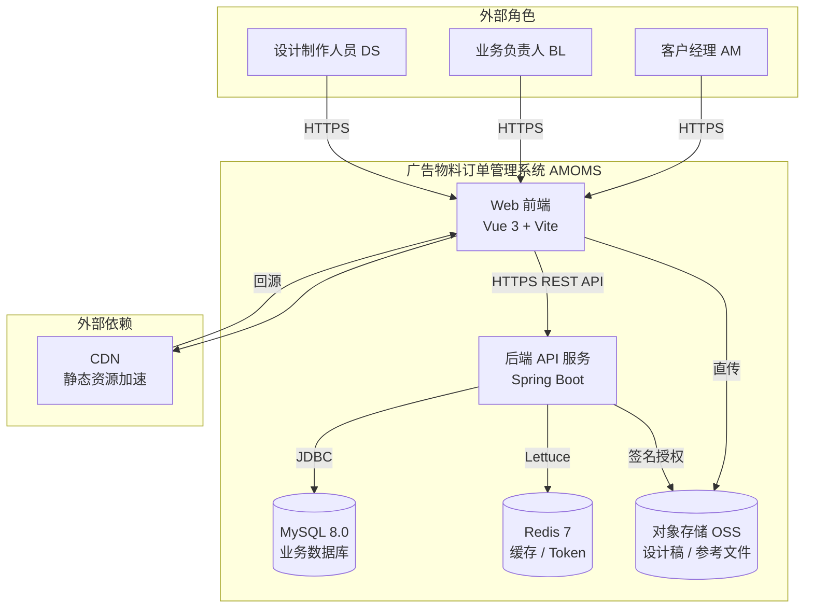
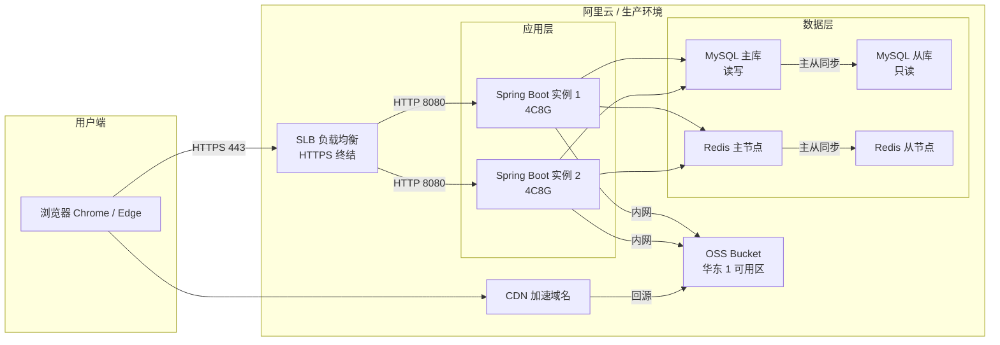
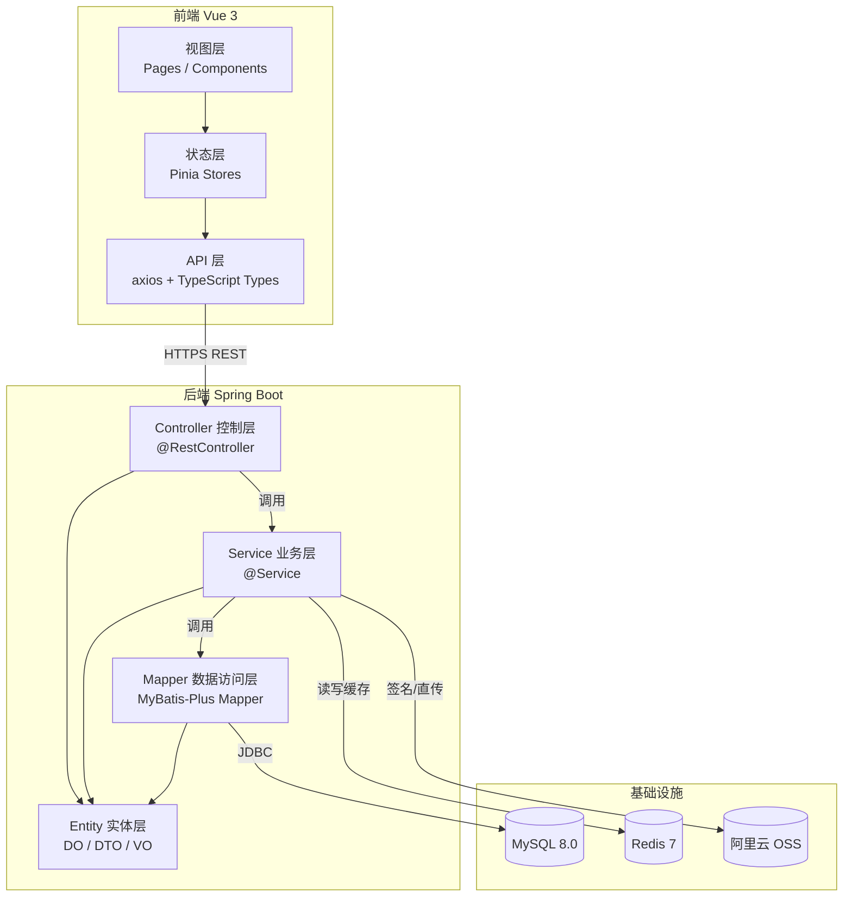

# 系统架构设计文档（瘦身版）

> 文档版本：v1.0  
> 适用范围：广告制作公司宣传物料订单管理系统 MVP  
> 前置文档：PRD.md / GLOSSARY.md / API.md / DATABASE.md / STATE_MACHINE.md / PERMISSION_MATRIX.md / FILE_CONTRACT.md  
> 定位：本文档只描述契约文档之外的架构决策与技术落地手段，不重复契约内容。

---

## 1. 系统上下文图



**说明：** 系统为内部使用的 B/S 架构，三类内部用户通过 Web 浏览器访问；前端直传文件到 OSS，后端仅负责业务逻辑与元数据管理；Redis 承担登录令牌、热点数据缓存与幂等控制。

---

## 2. 部署架构图



**部署说明：**
- 应用层双实例部署，SLB 做负载均衡与 HTTPS 终结，避免单点故障
- MySQL 一主一从，主库读写，从库用于报表查询与灾备（MVP 阶段报表需求少，从库以灾备为主）
- Redis 主从架构，主节点读写，从节点热备
- OSS 作为文件存储底座，CDN 加速静态资源与设计稿预览图分发
- 所有服务部署在同一可用区内，内网互通，减少网络延迟

---

## 3. 技术选型与裁决

### 3.1 后端框架裁决：Spring Boot vs NestJS

| 维度 | Spring Boot (Java 17) | NestJS (TypeScript) | 裁决 |
|---|---|---|---|
| 类型安全 | 强类型，编译期检查 | 强类型，编译期检查 | 持平 |
| 生态成熟度 | 极高，企业级方案齐全 | 较成熟，Node.js 生态 | Spring 胜出 |
| 事务与并发控制 | 声明式事务 @Transactional，成熟可靠 | TypeORM 事务能力弱于 Spring | Spring 胜出 |
| ORM 能力 | MyBatis-Plus / Spring Data JPA，生产验证充分 | TypeORM / Prisma，复杂查询能力一般 | Spring 胜出 |
| 乐观锁实现 | JPA @Version / MyBatis-Plus 原生支持 | 需自行实现或依赖插件 | Spring 胜出 |
| 团队技能曲线 | 广告行业 IT 团队 Java 人才储备更普遍 | 前端转全栈有学习曲线 | Spring 胜出 |
| 启动速度 / 开发体验 | 稍慢，冷启动 5-10s | 快，热更新即时 | NestJS 胜出 |
| 内存占用 | 较高（堆内存 512MB+） | 较低（128MB 可跑） | NestJS 胜出 |

**最终裁决：选用 Spring Boot 3.x + Java 17。**

**裁决理由：** 本系统核心是订单状态流转与并发控制（乐观锁、事务边界），Spring 生态在声明式事务、数据访问层、并发安全方面的成熟度远超 Node.js 体系。广告制作公司作为传统行业客户，Java 技术栈的人才供给与长期维护性更有保障。启动速度与内存占用的劣势在双实例 4C8G 部署下完全可接受。

### 3.2 完整技术栈清单

| 层次 | 技术选型 | 版本 | 选型理由 |
|---|---|---|---|
| 前端框架 | Vue 3 + Vite | 3.x / 5.x | Composition API，类型安全，开发体验优秀 |
| UI 组件库 | Element Plus | 最新稳定 | 企业中后台标配，组件齐全 |
| 状态管理 | Pinia | 最新 | Vue 3 官方推荐，轻量简洁 |
| 后端框架 | Spring Boot | 3.2.x | 裁决如上 |
| ORM | MyBatis-Plus | 3.5.x | 比 JPA 更灵活，比原生 MyBatis 少样板代码，支持乐观锁插件 |
| 数据库 | MySQL | 8.0 | 社区版免费，InnoDB 事务支持完善 |
| 缓存 | Redis | 7.x | 登录令牌存储 + 热点数据缓存 + 幂等控制 |
| 接口鉴权 | JWT（JJWT） | 0.12.x | 无状态 Token，水平扩展友好 |
| 参数校验 | Jakarta Validation | 3.0 | Spring Boot 3 内置，注解式校验 |
| 日志框架 | SLF4J + Logback | 内置 | Spring Boot 默认，性能可靠 |
| 连接池 | HikariCP | 内置 | Spring Boot 默认，性能最优 |
| Redis 客户端 | Lettuce | 内置 | 响应式，线程安全 |
| JSON 序列化 | Jackson | 内置 | Spring Boot 默认 |
| 单元测试 | JUnit 5 + Mockito | 内置 | 标准 Java 测试栈 |
| 构建工具 | Maven | 3.9.x | 企业项目标准 |
| 对象存储 | 阿里云 OSS | — | 与部署环境一致 |
| CDN | 阿里云 CDN | — | 加速静态资源与图片 |

---

## 4. 逻辑分层架构



**分层职责：**

| 层次 | 职责边界 | 禁止事项 |
|---|---|---|
| Controller | 参数校验、权限校验入口、请求路由、统一响应包装 | 禁止写业务逻辑，禁止直接操作数据库 |
| Service | 业务逻辑、事务控制、状态流转、缓存读写、调用 Mapper | 禁止直接输出 HTTP 响应，禁止拼接 SQL |
| Mapper / Repository | 数据访问、SQL 执行、结果映射 | 禁止写业务逻辑，禁止事务控制 |
| Entity（DO/DTO/VO） | 数据载体，无业务逻辑 | DO = 数据库表映射；DTO = 入参；VO = 出参，三者严格隔离 |

---

## 5. NFR 逐条技术落地映射

### 5.1 安全性（SEC）→ 技术手段

| NFR 编号 | 需求 | 落地技术手段 | 实现位置 |
|---|---|---|---|
| NFR-SEC-001 | XSS 字符清洗 | 前端：DOMPurify 库统一清洗所有 v-html 与用户输入；后端：Jackson 全局反序列化过滤 + 自定义 XssFilter 拦截器对请求参数做 HTML 标签转义 | 前端：全局指令 + 组件级封装；后端：`filter/XssFilter.java` |
| NFR-SEC-002 | 手机号脱敏 | 自定义 Jackson 序列化注解 `@PhoneDesensitize`，VO 层字段标注后自动脱敏；列表接口返回 VO 时自动生效 | 后端：`common/annotation/PhoneDesensitize.java` + 自定义 Serializer |
| NFR-SEC-003 | 登录令牌拦截 | Spring Security + JWT，`JwtAuthenticationFilter` 拦截所有 `/api/**` 请求，无 Token 或 Token 无效直接返回 401 | 后端：`security/JwtAuthenticationFilter.java` |
| NFR-SEC-004 | SQL 注入防护 | MyBatis-Plus 使用 `#{}` 预编译参数，禁止 `${}` 拼接；代码审查规则：所有动态 SQL 必须通过 QueryWrapper 构建 | 后端：Mapper 层全量使用 `#{}` |
| NFR-SEC-005 | 越权访问校验 | 自定义 `@DataPermission` 注解 + AOP 切面，在 Service 层校验当前用户是否有权访问目标订单数据，越权返回 403 | 后端：`aspect/DataPermissionAspect.java` |
| NFR-SEC-006 | 密码 bcrypt 存储 | Spring Security BCryptPasswordEncoder，强度 10 轮；数据库仅存哈希值，禁止明文或可逆加密 | 后端：`security/config/SecurityConfig.java` 中注册 Bean |
| NFR-SEC-007 | 登录失败锁定 | Redis 记录失败次数（key: `login:fail:{username}`），连续 5 次失败后设置锁定标识（key: `login:lock:{username}`），TTL 30 分钟 | 后端：`service/AuthService.java` 登录逻辑 |

### 5.2 媒体资源（MED）→ 技术手段

| NFR 编号 | 需求 | 落地技术手段 | 实现位置 |
|---|---|---|---|
| NFR-MED-001 | 参考图片 ≤ 5MB | 前端：上传前用 File.size 校验，超限直接拦截；后端：OSS 服务端做大小校验（签名时校验） | 前端：`utils/fileValidator.ts`；后端：`file/FileService.java` |
| NFR-MED-002 | 自动压缩 WebP | 前端：使用 browser-image-compression 库，上传前将 jpg/png 转换为 WebP 并压缩画质至 80% | 前端：`utils/imageCompressor.ts`，在上传组件中统一调用 |
| NFR-MED-003 | OSS 直传，DB 存 URL | 客户端直传方案：后端签发 STS 临时凭证 + Policy，前端拿到后直接 PUT 到 OSS，成功后回调后端保存 URL | 后端：`file/OssService.java`；前端：`utils/ossUploader.ts` |
| NFR-MED-004 | 文件格式白名单 | 前端：文件名后缀校验 + 文件头魔数检测（防止改后缀绕过）；后端：OSS Policy 中限定 content-length-range 与后缀 | 前后端双重校验 |
| NFR-MED-005 | 源文件 ≤ 100MB | 前端：上传前校验；后端：OSS Policy 中设置 `content-length-range` 上限为 104857600 字节 | 前后端 + OSS 三重限制 |
| NFR-MED-006 | 断点续传 | 使用 OSS SDK 分片上传（multipart upload），本地记录已上传分片 ID，刷新后可续传 | 前端：`utils/ossUploader.ts` 分片上传模式 |
| NFR-MED-007 | OSS 服务端加密 | Bucket 开启 SSE-OSS 加密（AES-256），在阿里云控制台配置，应用层无需改动 | 基础设施配置 |

### 5.3 性能（PER）→ 技术手段

| NFR 编号 | 需求 | 落地技术手段 | 实现位置 |
|---|---|---|---|
| NFR-PER-001 | 4G 弱网 LCP ≤ 1.5s | ① Vue Router 路由懒加载；② 静态资源 CDN 加速；③ 首屏关键 CSS 内联；④ 图片 WebP + 懒加载；⑤ Vite build 开启 tree-shaking + code splitting | 前端构建配置 + 组件级优化 |
| NFR-PER-002 | Cursor 游标分页 | 前端：封装 `useCursorPagination` 组合式函数，维护 `nextCursor` 状态；后端：Service 层用 `last_id` 游标查询，MyBatis-Plus QueryWrapper 拼接 `id < lastId` + `ORDER BY id DESC` + `LIMIT pageSize` | 前端：`composables/useCursorPagination.ts`；后端：`service/impl/OrderServiceImpl.java` |
| NFR-PER-003 | 订单详情 P95 ≤ 200ms | ① 订单详情接口单表查询 + 关联表用 JOIN（不超过 2 张）；② Redis 缓存热点订单详情（最近 1 小时被访问 ≥ 3 次的订单），TTL 5 分钟；③ 数据库订单表 `status`、`created_by`、`designer_id` 建索引 | 后端：缓存 + 索引优化 |
| NFR-PER-004 | 订单列表 P95 ≤ 300ms | ① 列表仅查主表字段，设计稿数量等用子查询或单独接口；② Cursor 分页避免深分页性能问题；③ 列表字段加覆盖索引（status, created_at, id） | 后端：SQL 优化 + 索引 |
| NFR-PER-005 | 乐观锁并发控制 | MyBatis-Plus 乐观锁插件 + `version` 字段，更新时自动追加 `WHERE version = ?`，版本不匹配则更新行数为 0，Service 层检测后抛出并发冲突异常 | 后端：`config/mybatis/MybatisPlusConfig.java` + `entity/Order.java` 的 `@Version` 注解 |
| NFR-PER-006 | 50 并发用户支持 | 双实例 4C8G 部署，HikariCP 连接池每实例 20 连接，理论可支撑 100+ 并发；Redis 连接池同样配置 | 部署配置 + 连接池调优 |
| NFR-PER-007 | CDN 静态资源加速 | 前端构建产物（JS/CSS/字体）上传 OSS 并绑定 CDN 域名，index.html 走应用服务器（保证版本更新即时） | 部署配置 |

### 5.4 可用性（AVA）→ 技术手段

| NFR 编号 | 需求 | 落地技术手段 | 实现位置 |
|---|---|---|---|
| NFR-AVA-001 | 月度可用率 ≥ 99.5% | 双实例部署 + SLB 健康检查（HTTP 健康检查路径 `/actuator/health`），单实例故障自动摘除；数据库主从切换保障 | 基础设施 + Spring Boot Actuator |
| NFR-AVA-002 | 每日自动备份，保留 30 天 | 阿里云 RDS 自动备份策略：每日凌晨全量备份 + 每小时增量 binlog，保留 30 天；OSS 文件开启版本控制 | 基础设施配置 |
| NFR-AVA-003 | MySQL 主从自动切换 | RDS 高可用版自带主从自动切换（60s 内完成），应用层使用读写分离地址，切换时自动重连 | 基础设施配置 |

---

## 6. 横切关注点架构位置

### 6.1 日志策略

| 日志层 | 技术 | 输出位置 | 级别配置 |
|---|---|---|---|
| 应用日志 | SLF4J + Logback | 控制台 + 滚动文件（`logs/app.log`），按天滚动，保留 30 天 | INFO（生产）/ DEBUG（开发） |
| 访问日志 | Spring Boot 内置 Tomcat AccessLog | `logs/access.log` | 记录所有 HTTP 请求的 URL、状态码、耗时 |
| 异常日志 | 全局异常处理器捕获 | `logs/error.log`，单独文件 | ERROR 级别，含完整堆栈 |
| SQL 日志 | MyBatis-Plus 性能分析插件 | 控制台（仅开发环境） | 开发环境输出 SQL 及执行时间，生产环境关闭 |

**日志统一格式：** `时间 | 级别 | 线程 | Logger名 | TraceId | 消息`  
**TraceId 实现：** 通过 MDC（Mapped Diagnostic Context）在请求入口注入唯一 TraceId，全链路透传，方便问题排查。

### 6.2 监控与告警

| 监控项 | 技术手段 | 告警阈值 | 通知方式 |
|---|---|---|---|
| 应用存活 | Spring Boot Actuator `/actuator/health` + 云监控心跳检测 | 连续 3 次心跳失败 | 钉钉群告警 |
| 接口响应时间 | Micrometer + Prometheus 指标采集 + Grafana 可视化 | P95 > 500ms 持续 5 分钟 | 钉钉群告警 |
| 错误率 | 全局异常处理器统计 5xx 比例 | 5xx 占比 > 5% 持续 3 分钟 | 钉钉群告警 |
| JVM 指标 | Micrometer JVM 指标（堆内存、GC、线程数） | 老年代使用率 > 80% 持续 10 分钟 | 钉钉群告警 |
| MySQL 指标 | 云监控（CPU、连接数、慢查询） | CPU > 70% 持续 5 分钟；慢查询 > 10 个/分钟 | 钉钉群告警 |
| Redis 指标 | 云监控（内存使用率、命中率） | 内存 > 80%；命中率 < 90% | 钉钉群告警 |
| 磁盘空间 | 云监控（系统盘 / 数据盘） | 使用率 > 80% | 邮件告警 |

### 6.3 缓存策略

| 缓存对象 | Key 格式 | TTL | 缓存位置 | 更新策略 |
|---|---|---|---|---|
| 登录用户信息 | `user:info:{userId}` | 30 分钟 | Redis | 用户信息变更时主动删除 |
| 登录 Token 映射 | `auth:token:{jti}` | 2 小时（与 Token 过期时间一致） | Redis | 登出时主动删除 |
| 订单详情（热点） | `order:detail:{orderId}` | 5 分钟 | Redis | 订单状态变更时主动删除 |
| 设计人员任务数 | `ds:task-count:{designerId}` | 2 分钟 | Redis | 分派 / 交付时主动删除 |
| 幂等控制（防重复提交） | `idempotent:{orderId}:{action}` | 10 秒 | Redis | 操作完成后自动过期 |
| 登录失败计数 | `login:fail:{username}` | 30 分钟 | Redis | 登录成功后删除 |

**缓存穿透防护：** 空值缓存（TTL 30s），避免不存在的订单 ID 穿透到数据库。  
**缓存击穿防护：** 热点订单详情使用互斥锁（Redis SETNX），缓存失效时仅一个请求回源。

### 6.4 XSS 清洗位置

```
前端层：
  ├─ 全局自定义指令 v-safe-html（封装 DOMPurify），替代原生 v-html
  ├─ 所有用户输入组件（el-input / el-input-number / el-textarea）
  │   封装为 SafeInput 组件，提交前自动清洗
  └─ 搜索框、修改意见、版本说明等文本提交统一走提交前清洗钩子

网络层：
  └─ axios 全局请求拦截器，对所有请求参数做 XSS 清洗（次要防线）

后端层：
  ├─ XssFilter（OncePerRequestFilter）：对所有请求参数、请求体做 HTML 转义
  │   使用 org.apache.commons.text.StringEscapeUtils.escapeHtml4
  └─ Jackson 全局配置：反序列化时注册 Xss 清洗 Deserializer
```

### 6.5 统一异常拦截器位置

```mermaid
graph TD
    A[Controller 接收请求] --> B[参数校验<br/>Jakarta Validation]
    B -->|校验失败| C[MethodArgumentNotValidException]
    B --> D[Service 业务逻辑]
    D -->|业务异常| E[BusinessException<br/>自定义异常]
    D -->|权限不足| F[AccessDeniedException]
    D -->|并发冲突| G[OptimisticLockException]
    D --> H[Mapper 数据访问]
    H -->|DB 异常| I[DataAccessException]
    C --> J[GlobalExceptionHandler<br/>@RestControllerAdvice]
    E --> J
    F --> J
    G --> J
    I --> J
    J --> K[统一响应体 Result<T><br/>code + message + data]
```

**全局异常处理器位置：** `common/exception/GlobalExceptionHandler.java`（`@RestControllerAdvice`）  
**职责：** 捕获所有异常，转换为统一响应格式（`code` + `message` + `data`），记录异常日志，防止堆栈信息泄露到前端。  
**错误码定义：** 见 API.md，本处不重复。

---

## 7. 契约文档引用（一句话）

| 主题 | 引用文档 | 说明 |
|---|---|---|
| 订单状态机与流转规则 | STATE_MACHINE.md | 状态定义、触发条件、副作用、事务边界，详见该文档 |
| 鉴权与越权控制 | PERMISSION_MATRIX.md | RBAC 权限矩阵、数据权限规则、接口权限标注，详见该文档 |
| 乐观锁实现 | DATABASE.md | 乐观锁字段定义、索引设计、表结构，详见该文档 |
| 状态流转副作用与事务边界 | STATE_MACHINE.md | 每条状态流转的事务范围与副作用列表，详见该文档 |
| API 接口契约与错误码 | API.md | 所有接口路径、入参出参、HTTP 状态码、业务错误码，详见该文档 |
| OSS 直传与文件契约 | FILE_CONTRACT.md | 直传流程、签名接口、文件格式白名单、大小限制，详见该文档 |

---

> **文档结束**  
> 本文档为架构设计瘦身版，仅包含契约文档之外的架构决策与技术落地手段。  
> 所有命名严格遵循 GLOSSARY.md 统一领域语言词汇表。
