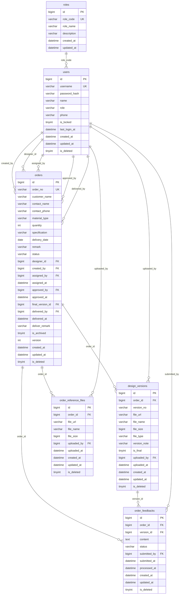

# 数据库设计文档

> 文档版本：v1.0  
> 数据库：MySQL 8.0+  
> 存储引擎：InnoDB  
> 字符集：utf8mb4 / utf8mb4_unicode_ci  
> 关联脚本：schema.sql（可直接执行）  
> 前置文档：PRD.md / GLOSSARY.md / API.md / STATE_MACHINE.md

---

## 一、设计原则与策略选择

### 1.1 删除策略裁决：软删除（is_deleted）

**本系统采用软删除策略，不使用物理外键级联删除。**

| 维度 | 软删除（is_deleted） | 物理外键 + 级联删除 | 裁决 |
|---|---|---|---|
| 数据完整性 | 高（历史数据全部保留） | 低（级联删除不可恢复） | 软删除胜出 |
| 审计追溯 | 完整保留所有操作痕迹 | 级联删除后无迹可寻 | 软删除胜出 |
| 订单业务需求 | 订单需永久留存作为业务凭证 | 物理删除违背业务常识 | 软删除胜出 |
| 查询复杂度 | 需额外加 `is_deleted = 0` 条件 | 简单直接 | 级联删除胜出 |
| 误操作风险 | 低（可恢复） | 高（误删无法恢复） | 软删除胜出 |

**裁决理由：**
1. 订单管理系统的核心资产是订单数据，任何订单、设计稿、修改意见都不应被物理删除，这是广告行业的基本业务要求（交付记录、版本追溯、纠纷举证）。
2. 软删除配合 `is_deleted` 索引，查询性能影响极小（WHERE 条件 + 索引过滤）。
3. MyBatis-Plus 内置逻辑删除插件，开发成本几乎为零。
4. 不使用物理外键级联删除，避免误操作导致整表数据被级联清空的风险。数据一致性由应用层（Service 事务）保障。

### 1.2 命名规范

| 项目 | 规范 | 示例 |
|---|---|---|
| 表名 | snake_case 复数 | `orders`、`design_versions` |
| 字段名 | snake_case 单数 | `order_no`、`customer_name` |
| 主键 | `id`（自增 BIGINT） | `id` |
| 外键 | `{entity}_id` | `order_id`、`designer_id` |
| 时间字段 | `_at` 后缀 | `created_at`、`assigned_at` |
| 布尔字段 | `is_` 前缀，TINYINT(1) | `is_archived`、`is_deleted` |
| 枚举字段 | VARCHAR(32) 存 code | `status` = `WAIT_APPROVE` |
| 普通索引 | `idx_{字段名}` | `idx_status` |
| 唯一索引 | `uk_{字段名}` | `uk_order_no` |
| 复合索引 | `idx_{表名缩写}_{字段1}_{字段2}` | `idx_order_feedback_status` |

> 所有命名严格遵循 GLOSSARY.md 统一领域语言词汇表，字段名与 GLOSSARY 第 5 节逐字对齐。

---

## 二、表结构总览

### 2.1 表清单（共 6 张，无第 7 张业务表）

| 序号 | 表名 | 中文名称 | 记录量级（MVP预估） | 核心作用 |
|---|---|---|---|---|
| 1 | `roles` | 角色字典表 | 4 条 | 用户角色枚举的物理存储，供权限判断引用 |
| 2 | `users` | 用户表 | < 100 条 | 系统内部用户账号与基本信息 |
| 3 | `orders` | 订单主表 | 数千~数万条 | 一笔订单的完整业务记录（核心表） |
| 4 | `design_versions` | 设计稿版本表 | 订单数 × 平均 3~5 版 | 订单下的设计稿版本迭代记录 |
| 5 | `order_feedbacks` | 订单修改意见表 | 订单数 × 平均 2~4 条 | 针对设计稿版本的修改意见记录 |
| 6 | `order_reference_files` | 订单参考文件表 | 订单数 × 平均 2~3 个 | 订单登记时的参考资料文件 |

### 2.2 表关系图

> 注：本系统不使用物理外键约束，数据一致性由应用层 Service 事务保障。图中 FK 标识仅表示逻辑关联关系。

---

## 三、各表字段详细说明

### 3.1 roles（角色字典表）

| 字段名 | 类型 | 必填 | 默认值 | 说明 |
|---|---|---|---|---|
| id | BIGINT | 是 | AUTO_INCREMENT | 主键ID |
| role_code | VARCHAR(32) | 是 | — | 角色编码（AM/BL/DS/GUEST），唯一索引 |
| role_name | VARCHAR(32) | 是 | — | 角色名称（中文） |
| description | VARCHAR(200) | 否 | NULL | 角色描述 |
| created_at | DATETIME | 是 | CURRENT_TIMESTAMP | 创建时间 |
| updated_at | DATETIME | 是 | CURRENT_TIMESTAMP ON UPDATE | 更新时间 |

**索引：**

| 索引名 | 类型 | 字段 | 用途 |
|---|---|---|---|
| PRIMARY | 主键 | id | 主键 |
| uk_role_code | 唯一索引 | role_code | 角色编码唯一 |

---

### 3.2 users（用户表）

| 字段名 | 类型 | 必填 | 默认值 | GLOSSARY 对应 | 说明 |
|---|---|---|---|---|---|
| id | BIGINT | 是 | AUTO_INCREMENT | id | 主键ID |
| username | VARCHAR(50) | 是 | — | username | 登录账号，唯一 |
| password_hash | VARCHAR(100) | 是 | — | password_hash | bcrypt密码哈希，强度≥10轮 |
| name | VARCHAR(20) | 是 | — | name | 用户姓名 |
| role | VARCHAR(32) | 是 | — | role | 角色编码（UserRole枚举：AM/BL/DS） |
| phone | VARCHAR(11) | 否 | NULL | phone | 手机号 |
| is_locked | TINYINT(1) | 是 | 0 | is_locked | 是否锁定（0-否 1-是） |
| last_login_at | DATETIME | 否 | NULL | last_login_at | 最后登录时间 |
| created_at | DATETIME | 是 | CURRENT_TIMESTAMP | created_at | 创建时间 |
| updated_at | DATETIME | 是 | CURRENT_TIMESTAMP ON UPDATE | — | 更新时间 |
| is_deleted | TINYINT(1) | 是 | 0 | is_deleted | 是否删除（0-否 1-是） |

**索引：**

| 索引名 | 类型 | 字段 | 用途 |
|---|---|---|---|
| PRIMARY | 主键 | id | 主键 |
| uk_username | 唯一索引 | username | 账号唯一 |
| idx_role | 普通索引 | role | 按角色查询用户列表 |
| idx_phone | 普通索引 | phone | 按手机号查找 |
| idx_is_deleted | 普通索引 | is_deleted | 软删除过滤 |

---

### 3.3 orders（订单主表）

| 字段名 | 类型 | 必填 | 默认值 | GLOSSARY 对应 | 说明 |
|---|---|---|---|---|---|
| id | BIGINT | 是 | AUTO_INCREMENT | id | 主键ID |
| order_no | VARCHAR(20) | 是 | — | order_no | 订单编号（ORD-YYYY-NNNNN），唯一 |
| customer_name | VARCHAR(100) | 是 | — | customer_name | 客户名称 |
| contact_name | VARCHAR(20) | 是 | — | contact_name | 联系人姓名 |
| contact_phone | VARCHAR(11) | 是 | — | contact_phone | 联系电话 |
| material_type | VARCHAR(32) | 是 | — | material_type | 物料类型（MaterialType枚举） |
| quantity | INT | 是 | — | quantity | 数量 |
| specification | VARCHAR(200) | 是 | — | specification | 规格说明 |
| delivery_date | DATE | 是 | — | delivery_date | 交付日期 |
| remark | VARCHAR(500) | 否 | NULL | remark | 备注说明 |
| status | VARCHAR(32) | 是 | CREATED | status | 订单状态（OrderStatus枚举） |
| designer_id | BIGINT | 否 | NULL | designer_id | 设计负责人ID |
| created_by | BIGINT | 是 | — | created_by | 创建人ID（客户经理） |
| assigned_by | BIGINT | 否 | NULL | assigned_by | 分派人ID（业务负责人） |
| assigned_at | DATETIME | 否 | NULL | assigned_at | 分派时间 |
| approved_by | BIGINT | 否 | NULL | approved_by | 定稿人ID |
| approved_at | DATETIME | 否 | NULL | approved_at | 定稿时间 |
| final_version_id | BIGINT | 否 | NULL | final_version_id | 定稿版本ID |
| delivered_by | BIGINT | 否 | NULL | delivered_by | 交付人ID |
| delivered_at | DATETIME | 否 | NULL | delivered_at | 交付时间 |
| deliver_remark | VARCHAR(100) | 否 | NULL | deliver_remark | 交付备注 |
| is_archived | TINYINT(1) | 是 | 0 | is_archived | 是否已归档 |
| version | INT | 是 | 0 | version | 乐观锁版本号 |
| created_at | DATETIME | 是 | CURRENT_TIMESTAMP | created_at | 创建时间 |
| updated_at | DATETIME | 是 | CURRENT_TIMESTAMP ON UPDATE | — | 更新时间 |
| is_deleted | TINYINT(1) | 是 | 0 | is_deleted | 是否删除 |

**索引：**

| 索引名 | 类型 | 字段 | 用途 | 强制要求 |
|---|---|---|---|---|
| PRIMARY | 主键 | id | 主键 | — |
| uk_order_no | 唯一索引 | order_no | 订单编号唯一 | ✅ 必须 |
| idx_status | 普通索引 | status | 按状态筛选订单 | ✅ 必须 |
| idx_designer_id | 普通索引 | designer_id | 设计师查询自己的订单 | ✅ 必须 |
| idx_created_by | 普通索引 | created_by | 客户经理查询自己的订单 | ✅ 必须 |
| idx_created_at_id | 复合索引 | created_at, id DESC | 全局列表 Cursor 游标分页 | ✅ 必须 |
| idx_assigned_at_id | 复合索引 | assigned_at, id DESC | 设计师任务列表 Cursor 游标分页 | ✅ 必须 |
| idx_delivery_date | 普通索引 | delivery_date | 按交期排序/筛选 | 补充 |
| idx_is_deleted | 普通索引 | is_deleted | 软删除过滤 | 补充 |

**乐观锁实现：** `version` 字段 + MyBatis-Plus `@Version` 注解，每次更新时自动 `version = version + 1`，版本不匹配则更新行数为 0，Service 层抛出 `ORDER_VERSION_CONFLICT` 异常。

---

### 3.4 design_versions（设计稿版本表）

| 字段名 | 类型 | 必填 | 默认值 | GLOSSARY 对应 | 说明 |
|---|---|---|---|---|---|
| id | BIGINT | 是 | AUTO_INCREMENT | id | 主键ID |
| order_id | BIGINT | 是 | — | order_id | 关联订单ID |
| version_no | VARCHAR(10) | 是 | — | version_no | 版本号（V1/V2/V3...） |
| file_url | VARCHAR(500) | 是 | — | file_url | 文件访问URL（OSS） |
| file_name | VARCHAR(200) | 是 | — | fileName | 原始文件名 |
| file_size | BIGINT | 是 | — | fileSize | 文件大小（字节） |
| file_type | VARCHAR(20) | 是 | — | fileType | 文件类型（扩展名） |
| version_note | VARCHAR(200) | 是 | — | versionNote | 版本说明 |
| is_final | TINYINT(1) | 是 | 0 | is_final | 是否最终版 |
| uploaded_by | BIGINT | 是 | — | uploaded_by | 上传人ID |
| uploaded_at | DATETIME | 是 | CURRENT_TIMESTAMP | uploaded_at | 上传时间 |
| created_at | DATETIME | 是 | CURRENT_TIMESTAMP | — | 创建时间 |
| updated_at | DATETIME | 是 | CURRENT_TIMESTAMP ON UPDATE | — | 更新时间 |
| is_deleted | TINYINT(1) | 是 | 0 | is_deleted | 是否删除 |

**索引：**

| 索引名 | 类型 | 字段 | 用途 | 强制要求 |
|---|---|---|---|---|
| PRIMARY | 主键 | id | 主键 | — |
| uk_order_version | 唯一索引 | order_id, version_no | 同一订单版本号唯一 | ✅ 必须（以复合索引体现 order_id + version_no） |
| idx_order_id | 普通索引 | order_id | 查询订单下的所有版本 | 补充 |
| idx_is_final | 普通索引 | is_final | 快速定位最终版 | 补充 |
| idx_uploaded_at | 普通索引 | uploaded_at | 按上传时间排序 | 补充 |
| idx_is_deleted | 普通索引 | is_deleted | 软删除过滤 | 补充 |

---

### 3.5 order_feedbacks（订单修改意见表）

| 字段名 | 类型 | 必填 | 默认值 | GLOSSARY 对应 | 说明 |
|---|---|---|---|---|---|
| id | BIGINT | 是 | AUTO_INCREMENT | id | 主键ID |
| order_id | BIGINT | 是 | — | order_id | 关联订单ID |
| version_id | BIGINT | 是 | — | version_id | 关联设计稿版本ID |
| content | TEXT | 是 | — | content | 修改意见内容 |
| status | VARCHAR(32) | 是 | PENDING | status | 意见状态（FeedbackStatus枚举） |
| submitted_by | BIGINT | 是 | — | submitted_by | 提交人ID |
| submitted_at | DATETIME | 是 | CURRENT_TIMESTAMP | submitted_at | 提交时间 |
| processed_at | DATETIME | 否 | NULL | processed_at | 处理时间 |
| created_at | DATETIME | 是 | CURRENT_TIMESTAMP | — | 创建时间 |
| updated_at | DATETIME | 是 | CURRENT_TIMESTAMP ON UPDATE | — | 更新时间 |
| is_deleted | TINYINT(1) | 是 | 0 | is_deleted | 是否删除 |

**索引：**

| 索引名 | 类型 | 字段 | 用途 | 强制要求 |
|---|---|---|---|---|
| PRIMARY | 主键 | id | 主键 | — |
| idx_order_feedback_status | 复合索引 | order_id, status | 按订单+状态查询意见 | ✅ 必须（order_id, feedback_status） |
| idx_version_id | 普通索引 | version_id | 查询某版本的意见 | 补充 |
| idx_submitted_by | 普通索引 | submitted_by | 按提交人筛选 | 补充 |
| idx_submitted_at | 普通索引 | submitted_at | 按提交时间排序 | 补充 |
| idx_is_deleted | 普通索引 | is_deleted | 软删除过滤 | 补充 |

---

### 3.6 order_reference_files（订单参考文件表）

| 字段名 | 类型 | 必填 | 默认值 | GLOSSARY 对应 | 说明 |
|---|---|---|---|---|---|
| id | BIGINT | 是 | AUTO_INCREMENT | id | 主键ID |
| order_id | BIGINT | 是 | — | order_id | 关联订单ID |
| file_url | VARCHAR(500) | 是 | — | file_url | 文件访问URL（OSS） |
| file_name | VARCHAR(200) | 是 | — | fileName | 原始文件名 |
| file_size | BIGINT | 是 | — | fileSize | 文件大小（字节） |
| uploaded_by | BIGINT | 是 | — | uploaded_by | 上传人ID |
| uploaded_at | DATETIME | 是 | CURRENT_TIMESTAMP | uploaded_at | 上传时间 |
| created_at | DATETIME | 是 | CURRENT_TIMESTAMP | — | 创建时间 |
| updated_at | DATETIME | 是 | CURRENT_TIMESTAMP ON UPDATE | — | 更新时间 |
| is_deleted | TINYINT(1) | 是 | 0 | is_deleted | 是否删除 |

**索引：**

| 索引名 | 类型 | 字段 | 用途 |
|---|---|---|---|
| PRIMARY | 主键 | id | 主键 |
| idx_order_id | 普通索引 | order_id | 查询订单下的参考文件 |
| idx_uploaded_at | 普通索引 | uploaded_at | 按上传时间排序 |
| idx_is_deleted | 普通索引 | is_deleted | 软删除过滤 |

---

## 四、枚举字段取值字典

> 所有枚举字段使用 VARCHAR(32) 存储编码值，**禁用 MySQL ENUM 类型**（修改枚举值需 ALTER TABLE，运维成本高）。

### 4.1 OrderStatus（订单状态）

| 存储值 | 中文名 | 说明 |
|---|---|---|
| WAIT_CREATE | 待登记 | 草稿状态，MVP不落库 |
| CREATED | 已登记（待分派） | 已提交，等待分派 |
| ASSIGNED | 已分派 | 已指定设计人员 |
| DESIGNING | 设计中 | 设计人员正在处理（含修改中） |
| WAIT_APPROVE | 待定稿 | 已提交设计稿，等待审核 |
| APPROVED | 已定稿 | 业务负责人确认终稿 |
| DELIVERED | 已交付 | 已交付归档 |
| CANCELLED | 已作废 | 订单作废终止 |

### 4.2 MaterialType（物料类型）

| 存储值 | 中文名 |
|---|---|
| POSTER | 海报 |
| FLYER | 宣传单 |
| BUSINESS_CARD | 名片 |
| BROCHURE | 画册 |
| BANNER | 喷绘 |
| OTHER | 其他 |

### 4.3 UserRole（用户角色）

| 存储值 | 中文名 |
|---|---|
| AM | 客户经理 |
| BL | 业务负责人 |
| DS | 设计制作人员 |
| GUEST | 访客（不落库） |

### 4.4 FeedbackStatus（修改意见状态）

| 存储值 | 中文名 |
|---|---|
| PENDING | 待处理 |
| PROCESSED | 已处理 |

---

## 五、索引设计汇总与性能评估

### 5.1 强制要求索引落实情况

| 强制索引 | 所在表 | 索引名 | 落实状态 |
|---|---|---|---|
| uk_order_no | orders | uk_order_no | ✅ 已落实 |
| idx_status | orders | idx_status | ✅ 已落实 |
| idx_designer_id | orders | idx_designer_id | ✅ 已落实 |
| idx_created_by | orders | idx_created_by | ✅ 已落实 |
| Cursor 分页复合索引 (created_at, id) | orders | idx_created_at_id | ✅ 已落实 |
| Cursor 分页复合索引 (assigned_at, id) | orders | idx_assigned_at_id | ✅ 已落实 |
| design_versions(order_id, version_no) | design_versions | uk_order_version | ✅ 已落实（唯一复合索引） |
| order_feedbacks(order_id, feedback_status) | order_feedbacks | idx_order_feedback_status | ✅ 已落实（字段名为 status） |

### 5.2 Cursor 游标分页索引说明

**为什么用复合索引 (created_at, id DESC) 而不是单列索引？**

Cursor 分页的核心查询条件为 `WHERE created_at < lastCursorTime OR (created_at = lastCursorTime AND id < lastCursorId) ORDER BY created_at DESC, id DESC LIMIT ?`。使用 (created_at, id) 联合索引可以让 MySQL 在索引树上直接定位到游标位置，无需回表或文件排序，保证大数据量下仍保持稳定查询性能。

**设计师视角的列表**使用 (assigned_at, id DESC) 复合索引，因为设计师的"我的任务"是按分派时间排序的。

---

## 六、乐观锁与并发控制

### 6.1 实现机制

- **字段：** `orders.version`（INT NOT NULL DEFAULT 0）
- **框架支持：** MyBatis-Plus 乐观锁插件（`@Version` 注解）
- **工作原理：** 更新时自动追加 `WHERE version = ?`，并将 `version = version + 1`。如果版本不匹配（其他线程已修改），更新影响行数为 0。
- **异常处理：** Service 层检测到更新行数为 0 时，抛出 `ORDER_VERSION_CONFLICT` 业务异常，HTTP 状态码 409。

### 6.2 受影响的写操作

所有订单状态流转操作均携带 `version` 参数，受乐观锁保护：
- PUT `/orders/{id}`（编辑订单）
- PUT `/orders/{id}/assign`（分派订单）
- PUT `/orders/{id}/accept`（接收任务）
- PUT `/orders/{id}/reject`（驳回设计）
- PUT `/orders/{id}/approve`（确认终稿）
- PUT `/orders/{id}/deliver`（标记交付）
- PUT `/orders/{id}/cancel`（作废订单）
- POST `/design-versions`（上传设计稿）
- POST `/order-feedbacks`（提交意见）

---

## 七、GLOSSARY 一致性自检表

### 7.1 orders 表字段一致性

| 字段名（snake_case） | GLOSSARY 字段编码 | Java 字段 | TS 字段 | 一致性 |
|---|---|---|---|---|
| id | id | id | id | ✅ |
| order_no | order_no | orderNo | orderNo | ✅ |
| customer_name | customer_name | customerName | customerName | ✅ |
| contact_name | contact_name | contactName | contactName | ✅ |
| contact_phone | contact_phone | contactPhone | contactPhone | ✅ |
| material_type | material_type | materialType | materialType | ✅ |
| quantity | quantity | quantity | quantity | ✅ |
| specification | specification | specification | specification | ✅ |
| delivery_date | delivery_date | deliveryDate | deliveryDate | ✅ |
| remark | remark | remark | remark | ✅ |
| status | status | status | status | ✅ |
| designer_id | designer_id | designerId | designerId | ✅ |
| created_by | created_by | createdBy | createdBy | ✅ |
| assigned_by | assigned_by | assignedBy | assignedBy | ✅ |
| assigned_at | assigned_at | assignedAt | assignedAt | ✅ |
| approved_by | approved_by | approvedBy | approvedBy | ✅ |
| approved_at | approved_at | approvedAt | approvedAt | ✅ |
| final_version_id | final_version_id | finalVersionId | finalVersionId | ✅ |
| delivered_by | delivered_by | deliveredBy | deliveredBy | ✅ |
| delivered_at | delivered_at | deliveredAt | deliveredAt | ✅ |
| deliver_remark | deliver_remark | deliverRemark | deliverRemark | ✅ |
| is_archived | is_archived | archived | isArchived | ✅ |
| version | version | version | version | ✅ |
| created_at | created_at | createdAt | createdAt | ✅ |
| is_deleted | is_deleted | deleted | isDeleted | ✅ |

### 7.2 design_versions 表字段一致性

| 字段名（snake_case） | GLOSSARY 字段编码 | Java 字段 | TS 字段 | 一致性 |
|---|---|---|---|---|
| id | id | id | id | ✅ |
| order_id | order_id | orderId | orderId | ✅ |
| version_no | version_no | versionNo | versionNo | ✅ |
| file_url | file_url | fileUrl | fileUrl | ✅ |
| file_name | file_name | fileName | fileName | ✅ |
| file_size | file_size | fileSize | fileSize | ✅ |
| file_type | file_type | fileType | fileType | ✅ |
| version_note | version_note | versionNote | versionNote | ✅ |
| is_final | is_final | finalVersion | isFinal | ✅（Java 用 finalVersion 因 final 为关键字） |
| uploaded_by | uploaded_by | uploadedBy | uploadedBy | ✅ |
| uploaded_at | uploaded_at | uploadedAt | uploadedAt | ✅ |
| is_deleted | is_deleted | deleted | isDeleted | ✅ |

### 7.3 order_feedbacks 表字段一致性

| 字段名（snake_case） | GLOSSARY 字段编码 | Java 字段 | TS 字段 | 一致性 |
|---|---|---|---|---|
| id | id | id | id | ✅ |
| order_id | order_id | orderId | orderId | ✅ |
| version_id | version_id | versionId | versionId | ✅ |
| content | content | content | content | ✅ |
| status | status | status | status | ✅ |
| submitted_by | submitted_by | submittedBy | submittedBy | ✅ |
| submitted_at | submitted_at | submittedAt | submittedAt | ✅ |
| processed_at | processed_at | processedAt | processedAt | ✅ |
| is_deleted | is_deleted | deleted | isDeleted | ✅ |

### 7.4 users 表字段一致性

| 字段名（snake_case） | GLOSSARY 字段编码 | Java 字段 | TS 字段 | 一致性 |
|---|---|---|---|---|
| id | id | id | id | ✅ |
| username | username | username | username | ✅ |
| password_hash | password_hash | passwordHash | —（不返回前端） | ✅ |
| name | name | name | name | ✅ |
| role | role | role | role | ✅ |
| phone | phone | phone | phone | ✅ |
| is_locked | is_locked | locked | isLocked | ✅ |
| last_login_at | last_login_at | lastLoginAt | lastLoginAt | ✅ |
| created_at | created_at | createdAt | createdAt | ✅ |
| is_deleted | is_deleted | deleted | isDeleted | ✅ |

### 7.5 order_reference_files 表字段一致性

| 字段名（snake_case） | GLOSSARY 字段编码 | Java 字段 | TS 字段 | 一致性 |
|---|---|---|---|---|
| id | id | id | id | ✅ |
| order_id | order_id | orderId | orderId | ✅ |
| file_url | file_url | fileUrl | fileUrl | ✅ |
| file_name | file_name | fileName | fileName | ✅ |
| file_size | file_size | fileSize | fileSize | ✅ |
| uploaded_by | uploaded_by | uploadedBy | uploadedBy | ✅ |
| uploaded_at | uploaded_at | uploadedAt | uploadedAt | ✅ |
| is_deleted | is_deleted | deleted | isDeleted | ✅ |

**自检结论：所有字段与 GLOSSARY.md 第 5 节关键字段命名映射表 100% 一致。**

---

## 八、初始化数据说明

### 8.1 roles 表初始化数据（4 条）

| id | role_code | role_name | description |
|---|---|---|---|
| 1 | GUEST | 访客 | 未登录用户，无任何操作权限 |
| 2 | AM | 客户经理 | 订单发起人，负责客户对接与订单登记 |
| 3 | BL | 业务负责人 | 订单管理者，负责分派、审核、交付 |
| 4 | DS | 设计制作人员 | 设计执行者，负责设计稿上传与迭代 |

### 8.2 users 表初始化数据（6 个测试用户）

| id | username | name | role | 初始密码 |
|---|---|---|---|---|
| 1 | am_zhangsan | 张三 | AM | 123456 |
| 2 | am_lisi | 李四 | AM | 123456 |
| 3 | bl_wangwu | 王五 | BL | 123456 |
| 4 | ds_liming | 李明 | DS | 123456 |
| 5 | ds_zhaoliu | 赵六 | DS | 123456 |
| 6 | ds_qianqi | 钱七 | DS | 123456 |

> **说明：** 初始化仅包含角色字典与测试用户数据，**不包含任何业务订单、设计稿、修改意见**。密码使用 bcrypt 10 轮哈希存储。脚本使用 INSERT IGNORE 保证可重复执行。

---

## 九、禁止项说明

| 禁止项 | 说明 |
|---|---|
| ❌ 禁止新增第 7 张业务表 | 如需扩展，必须先更新 GLOSSARY 与本设计文档 |
| ❌ 禁止使用 MySQL ENUM 类型 | 所有枚举用 VARCHAR(32) 存编码值 |
| ❌ 禁止使用物理外键 + 级联删除 | 数据一致性由应用层事务保障 |
| ❌ 禁止使用 offset 分页 | 所有列表使用 Cursor 游标分页 |
| ❌ 禁止在数据库中存储文件二进制 | 所有文件直传 OSS，数据库仅存 URL |
| ❌ 禁止硬编码枚举值 | 枚举值定义在代码枚举类中，与 GLOSSARY 一致 |

---

> **文档结束**  
> 所有字段命名、枚举值、索引设计严格遵循 GLOSSARY.md 统一领域语言词汇表。  
> 脚本 schema.sql 可在 MySQL 8.0 空库中直接执行，零报错。
